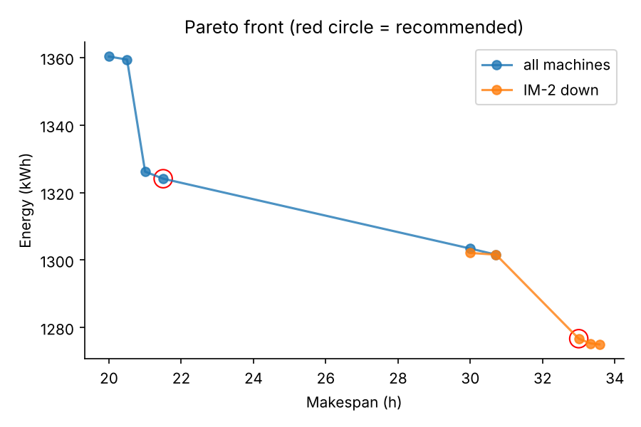

# mfg-agent · Manufacturing Assistant Agent

A small LLM agent for a manufacturing shop floor. It decides by itself which tool to use:

1. **Equipment-manual RAG**: answers questions about operation, alarm codes, maintenance and troubleshooting from equipment manuals, and cites the manual section it used.
2. **Multi-objective scheduling optimizer (NSGA-II)**: assigns machining and molding jobs to machines while minimizing both **makespan** and **energy use**. It returns the Pareto front and a recommended trade-off plan, and re-plans when a machine goes down.

The NSGA-II part reuses the method from my undergraduate thesis on multi-objective resource reconfiguration. Here it is applied to a civilian job-shop setting and exposed as a tool the LLM can call.

```
user question
    │
    ▼
LLM (qwen-plus or DeepSeek, function calling) ──► search_manual ──► embed query → cosine top-k over manual chunks
    │        ▲                ──► get_shop_info
    │        └── tool results ──► optimize_schedule ──► NSGA-II → Pareto front → pick knee point
    ▼
answer with citations / schedule + trade-off explanation
```

## Example questions

- `ALM 2010 气压不足是什么原因？` → searches the CNC manual and answers with the section it came from
- `帮我排一下这批任务，尽量兼顾工期和电费` → runs NSGA-II and explains the recommended plan
- `IM-2 注塑机坏了，重新排一下` → re-optimizes without IM-2 and compares with the previous plan
- `AGV 报 E04，处理完以后今天的任务还能按原计划完成吗？` → uses both tools in one conversation

## Project layout

| File | What it does |
|---|---|
| `ingest.py` | Splits the manuals into chunks: first by `##` section, then long sections with a sliding window (400 chars, 80 overlap, cut at sentence ends). Each chunk gets a `doc title > section` prefix. Writes `data/chunks.jsonl` |
| `rag.py` | Batch embedding (text-embedding-v4), vector cache in `.npy`, cosine top-k retrieval, and a citation-style answer prompt that refuses when the manual has no answer |
| `optimizer.py` | NSGA-II from scratch: fast non-dominated sorting, crowding distance, binary tournament, uniform crossover, mutation, elitism. Objectives: makespan and energy (processing + idle). Choices: knee point, fastest, or lowest-energy plan |
| `agent.py` | Function-calling loop (max 6 steps), tool error handling, conversation memory, and a JSONL log of tool calls, latency and tokens |
| `eval_rag.py` | Retrieval evaluation on hand-written questions phrased differently from the manuals: hit@1, hit@3, MRR |
| `data/` | 3 sample equipment manuals, the shop data (7 machines, 24 jobs) and the evaluation questions |

## Run it

```bash
pip install -r requirements.txt
export DASHSCOPE_API_KEY=sk-...                 # Alibaba Cloud Model Studio (DashScope)
export DASHSCOPE_BASE_URL=https://...           # optional: your workspace's OpenAI-compatible endpoint
# optional: use DeepSeek as the chat model (embeddings still come from DashScope)
# export CHAT_PROVIDER=deepseek DEEPSEEK_API_KEY=sk-...

python ingest.py      # build data/chunks.jsonl
python eval_rag.py    # retrieval evaluation
python optimizer.py   # run the optimizer alone and save pareto.png
python agent.py       # chat with the agent
```

## Results

**Retrieval (`eval_rag.py`, 15 questions, text-embedding-v4, chunk size 400 / overlap 80):**

| hit@1 | hit@3 | MRR |
|---|---|---|
| 93% (14/15) | 93% | 0.93 |

The one miss is *"料筒还没热透就转螺杆会有什么后果？"* ("what happens if the screw turns before the barrel is fully heated?"). The answer is one sentence inside the start-up procedure section, but retrieval returns the material temperature table instead, because that table matches the "temperature" wording more closely. The corpus is small (27 chunks), so these numbers are optimistic. A larger question set and real manuals come next.

**Scheduling (`optimizer.py`):** when IM-2 is taken offline, molding becomes the bottleneck. The recommended plan moves from 21.5 h / 1324.1 kWh to 33.0 h / 1276.7 kWh.



## How this was built

Built with AI-assisted coding (Claude Code). I chose the problem and the architecture, ran the evaluation, reviewed the agent's answers against the manuals, and drove the fixes. For example, I found that the model was adding troubleshooting steps that are not in the manual, so I tightened the grounding rules in the prompt. I also found that it misread the trade-off between plans, so I made the optimizer return the fastest and lowest-energy plans explicitly.

## Limitations and next steps

- The three manuals are **synthetic sample documents** written for this project. Next step: real public equipment manuals (PDF parsing, page-level citations).
- The evaluation set is small. Next steps: a larger question set, chunk-size comparison, hybrid BM25 + vector retrieval, reranking, and answer-level grading.
- The scheduling model is simplified: jobs are independent, with no sequence-dependent setup or due dates.
- Planned: FastAPI endpoint and Docker image.
